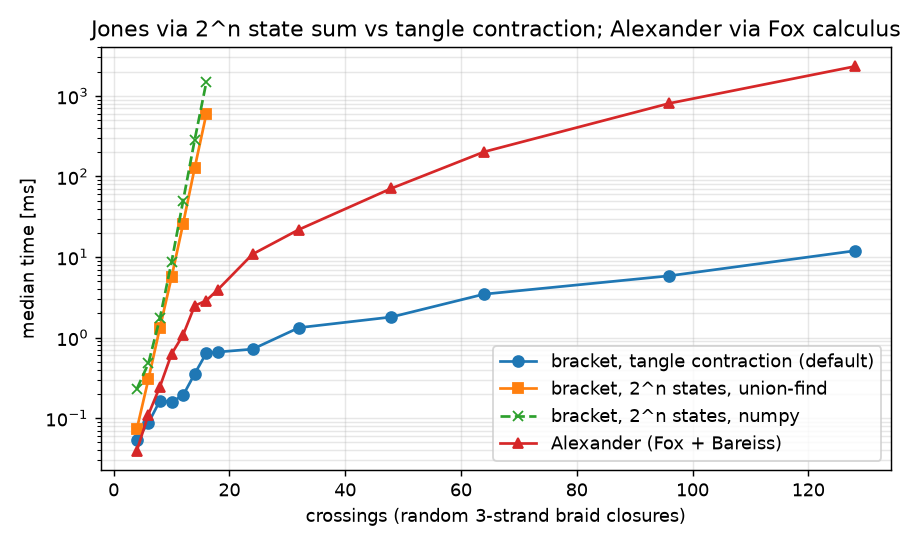

# knotlab · Knot-Theory-3D

**Exact Jones and Alexander polynomials from PD codes and braid words, with independent cross-checks and an interactive WebGL torus-knot viewer.**

[](https://github.com/Cyb0rg137ms/Knot-Theory-3D-Interactive-WebGL-Topology-Visualizer/actions/workflows/ci.yml)

[](LICENSE)



*Measured on this repo's benchmark (`knotlab bench`, random 3-strand braid closures, median of 3, 8 vCPU, Python 3.13). The default tangle-contraction bracket stays in milliseconds at 128 crossings. The two $2^n$ state sums become unusable before 20 crossings.*

## Why it matters

Knot invariants are easy to get subtly wrong. Sign conventions, mirror images and normalisation all differ between sources, and v1 of this repo shipped lookup tables with wrong entries (its figure-eight Jones had $V(1) = -1$; every knot has $V(1)=1$). knotlab computes every value from the diagram. It then checks each result against an invariant computed by a different algorithm: the determinant must agree between $|\Delta(-1)|$ (Fox calculus, linear algebra) and $|V(-1)|$ (Kauffman state sum, combinatorics). The values are also checked against KnotInfo.

## Key results

| What | Result | Reproduce |
|---|---|---|
| Knot table (all 14 prime knots ≤ 7 crossings) | **14/14**: $|\Delta(-1)| = |V(-1)| =$ KnotInfo determinant | `knotlab bench` |
| Jones/Alexander vs KnotInfo (3_1, 4_1, 5_1, 5_2, 6_1, 7_1) | exact match | `pytest tests/test_knotlab.py` |
| Three bracket engines | identical on table + 40 random braids | `pytest -k engines` |
| Bracket, 16 crossings | contraction **0.64 ms** · union-find 591 ms · NumPy 1468 ms | `knotlab bench` |
| Bracket, 128 crossings | contraction **11.9 ms** (state sum: infeasible, $2^{128}$ states) | `knotlab bench` |
| Alexander (Fox + Bareiss), 32 / 128 crossings | 21.9 ms / 2.32 s | `knotlab bench` |
| Torus knots: closed form vs Fox calculus | equal for T(2,3), T(2,5), T(3,4), T(3,5), T(2,9) | `pytest -k torus` |
| Python tests / web tests | 68 passed / 3 passed (vitest) + `tsc` build | `pytest` · `cd web && npm test && npm run build` |

<details><summary>Full scaling table (ms, median of 3)</summary>

| crossings | contraction | union-find 2^n | NumPy 2^n | Alexander |
|---:|---:|---:|---:|---:|
| 4 | 0.05 | 0.07 | 0.23 | 0.04 |
| 8 | 0.16 | 1.33 | 1.75 | 0.25 |
| 12 | 0.19 | 25.94 | 49.80 | 1.08 |
| 14 | 0.36 | 127.59 | 284.03 | 2.48 |
| 16 | 0.64 | 591.25 | 1467.52 | 2.88 |
| 32 | 1.33 | – | – | 21.91 |
| 64 | 3.46 | – | – | 202.22 |
| 128 | 11.94 | – | – | 2319.27 |

Raw data: [`docs/assets/bench.json`](docs/assets/bench.json). Timings depend on the machine. The ratios are what matters.
</details>

## Architecture

```mermaid
flowchart LR
    N[named knot / T&#40;p,q&#41;] --> FB[from_braid]
    B[braid word] --> FB --> PD[PD code]
    PD --> J[Kauffman bracket<br/>tangle contraction]
    PD --> JR[2^n state sums<br/>union-find · NumPy]
    PD --> A[Fox matrix +<br/>Bareiss det over Z t]
    J --> V["Jones V(t)"]
    JR -. cross-check .-> V
    A --> D["Alexander Δ(t)"]
    V --> X{"|V(−1)| = |Δ(−1)|"}
    D --> X
    G[torus curve +<br/>closed-form Δ] --> W[web viewer<br/>React Three Fiber]
```



Module-by-module details are in [docs/ARCHITECTURE.md](docs/ARCHITECTURE.md).

## 60-second quickstart

```bash
git clone https://github.com/Cyb0rg137ms/Knot-Theory-3D-Interactive-WebGL-Topology-Visualizer && cd Knot-Theory-3D-Interactive-WebGL-Topology-Visualizer
pip install -e ".[dev]"
knotlab invariants figure_eight          # Jones, Alexander, determinant, PD code as JSON
knotlab braid 1 1 1 2 -1 2               # any braid closure (here 5_2)
pytest -q && knotlab bench --quick --out /tmp/bench
cd web && npm ci && npm run dev          # viewer at http://localhost:5173
```

Docker (CLI only): `docker build -t knotlab . && docker run --rm knotlab invariants "T(3,4)"`

## Usage

```python
from knotlab import alexander, determinant, from_braid, jones, knot, torus_braid
from knotlab.poly import format_poly

pd = knot("5_2")
format_poly(jones(pd))        # '-t^6 + t^5 - t^4 + 2t^3 - t^2 + t'
format_poly(alexander(pd))    # '2t - 3 + 2t^-1'
determinant(pd)               # 7

big = from_braid(torus_braid(2, 41))   # 41 crossings; contraction makes this instant
jones(big, method="contract")          # method: "contract" | "reference" | "numpy"
```

The v1 API still works, and its values are now computed:

```python
from invariants.jones import JonesPolynomial
from invariants.alexander import AlexanderPolynomial
str(JonesPolynomial.from_knot("figure_eight"))                    # 't^2 - t + 1 - t^-1 + t^-2'
AlexanderPolynomial.from_seifert_matrix([[-1, 1], [0, -1]]).laurent()  # t - 1 + t^-1 (det(M − tMᵀ))
```

More: [`examples/invariants_tour.py`](examples/invariants_tour.py).

## Design decisions and trade-offs

- **PD codes as the core representation.** They are unambiguous (KnotTheory/KnotInfo convention), cheap to validate, and every algorithm reads them directly. Braid words and names are front-ends.
- **Exact arithmetic everywhere.** Integer Laurent polynomials, plus fraction-free Bareiss elimination for the Alexander determinant, so there is no floating-point tolerance anywhere in an invariant.
- **Contraction over brute force.** The default bracket tracks boundary pairings instead of enumerating $2^n$ states. On narrow diagrams this is ~900× faster at 16 crossings and reaches 128 crossings. The brute-force engines are kept because they are simple enough to trust and serve as the oracle in tests.
- **A negative result kept on purpose.** The NumPy-vectorised state sum is *slower* than the plain union-find loop (2.5× at 16 crossings). Label propagation needs many full-array passes, which costs more than the Python loop saves. It stays as a third independent engine and is not presented as an optimisation.
- **Independent cross-checks instead of tables.** Reference values (KnotInfo determinants) appear only in tests and the benchmark report, never inside an algorithm.
- **Browser stays self-contained.** The viewer computes the torus-knot Δ in TypeScript (exact integer division) instead of calling a Python server. The trade-off is that the browser supports torus knots only.

## Limitations and roadmap

Limitations (full list in [docs/LIMITATIONS.md](docs/LIMITATIONS.md)):
- Knots only, no links.
- Contraction is still exponential for wide diagrams, and the state sums are capped at 22 crossings.
- Alexander uses pure-Python exact arithmetic, taking about 2.3 s at 128 crossings.
- The viewer renders torus knots only.
- The Gauss-code R1 simplifier is the v1 heuristic (now seam-aware).

Roadmap:
- [ ] Multivariable Alexander and the link Jones polynomial
- [ ] HOMFLY-PT via the same contraction scheme
- [ ] Better contraction ordering (tree-width heuristics) for wide diagrams
- [ ] Arbitrary PD codes rendered in the viewer (via a WASM/Pyodide build of knotlab)
- [ ] Code-splitting the 1.1 MB web bundle

## Citation

```bibtex
@software{knotlab2026,
  author  = {Cyb0rg137ms},
  title   = {knotlab: Exact Knot Invariants with Independent Cross-Checks and a WebGL Torus-Knot Viewer},
  year    = {2026},
  version = {2.0.0},
  url     = {https://github.com/Cyb0rg137ms/Knot-Theory-3D-Interactive-WebGL-Topology-Visualizer}
}
```

Reference data: C. Livingston and A. H. Moore, *KnotInfo: Table of Knot Invariants*, knotinfo.math.indiana.edu.

## License

MIT. See [LICENSE](LICENSE). The v1 README is preserved at [docs/README_v1.md](docs/README_v1.md).
